<p align="center">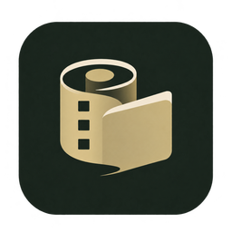</p>
<h1 align="center">Film Album</h1>
<p align="center">A local-first film archive and photobook workspace.</p>
<p align="center"><a href="README.md">简体中文</a> · English · <a href="#interface-tour">UI tour</a> · <a href="https://github.com/JackerKun/FilmAlbum/releases">Downloads</a> · <a href="BUILDING.md">Build and release guide</a></p>

Film Album connects rolls, individual frames, multiple scans, physical negative locations, photographic projects, maps and print layouts. It runs as a macOS / Windows desktop application or a local web application.

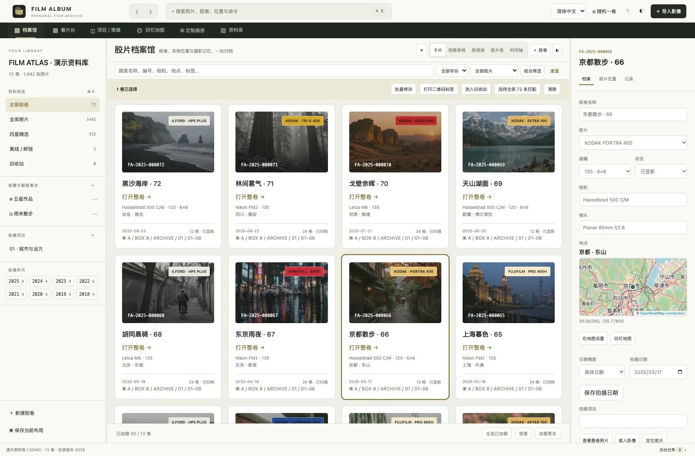

_Actual application UI with built-in synthetic demo data. See the [interface tour](#interface-tour) for entry points and controls._

**Preview software.** [3.0.1](https://github.com/JackerKun/FilmAlbum/releases/tag/v3.0.1) passed native builds, startup, thumbnails and original / PDF save checks on Apple Silicon Mac, Intel Mac, Windows x64 and Windows ARM64. These automated checks do not represent full manual acceptance of every feature. Distribution signing and Apple notarization are not configured by default.

## Download

Visit [Releases](https://github.com/JackerKun/FilmAlbum/releases) and select:

| Device                       | Package                                       |
| ---------------------------- | --------------------------------------------- |
| Apple Silicon Mac, macOS 13+ | `FilmAlbum-<version>-mac-arm64.dmg`           |
| Intel Mac, macOS 13+         | `FilmAlbum-<version>-mac-x64.dmg`             |
| Windows, Intel / AMD x64     | `FilmAlbum-<version>-windows-x64-setup.exe`   |
| Windows ARM64                | `FilmAlbum-<version>-windows-arm64-setup.exe` |

ZIP archives are also available. Extract the complete Windows ZIP before starting `Film Album.exe`. End users do not need Node.js or Xcode. Release assets include `SHA256SUMS` for download verification.

## Features

- Roll cards, editable archive tables, film shelves and a chronological timeline.
- Distinct 135 cassette / perforated film and 120 spool / backing-paper unrolling interactions.
- Single, two-image and four-image review, thumbnail navigation, ratings, color labels, EXIF and an RGB histogram.
- Combined filters for location, roll, dates, film format / type / stock, camera, lens, tags, rating, storage volume and online status.
- Multiple scans per frame, primary versions, permanent roll codes and physical negative locations with QR labels.
- Projects, chapters, candidate / final selections and a curation canvas.
- A map with photo previews, explicit location confirmation, place lookup and configurable default country; China is the default view.
- Photobooks with multiple size presets, detailed asset filters, millimeter geometry, corner resizing, drag cropping, alignment, bleed and print PDF export.
- External-volume references, offline previews, integrity checks, recoverable trash and verified backups / restores.

See the [Chinese usage guide](docs/USER_GUIDE.md) for detailed workflows. The interface supports Simplified Chinese and English for major navigation and common controls; some dynamic messages remain untranslated.

## Interface tour

These are real **3.0.1** screenshots of the built-in demo library: **8 rolls and 98 visible synthetic images**, with multiple scans, coordinates, projects, a photobook and disconnected-storage examples. The landscapes are generated locally; no personal photographs are included. Screenshots use the Simplified Chinese UI; English is available in the top language selector. Click images for a larger view and expand the additional examples below.

### From a roll to individual frames

<details>
<summary>135 and 120: distinct spools, perforations and unrolling interactions</summary>

**Open:** enter a roll from Archive, then choose **Film strip** in the light table. Drag the gold leader / take-up spool or use the slider. Drag horizontally to browse and double-click a frame to review it.

**135:** a cassette and film with two rows of perforations; pull out and rewind.

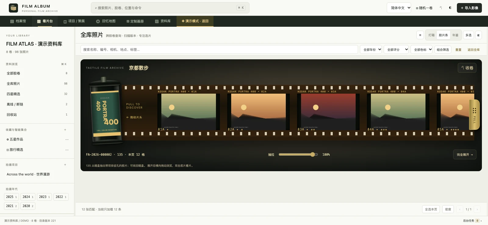

**120:** supply spool, backing paper and take-up spool, with wide unperforated film. Frame proportions follow the selected 6×4.5 / 6×6 / 6×7 format.

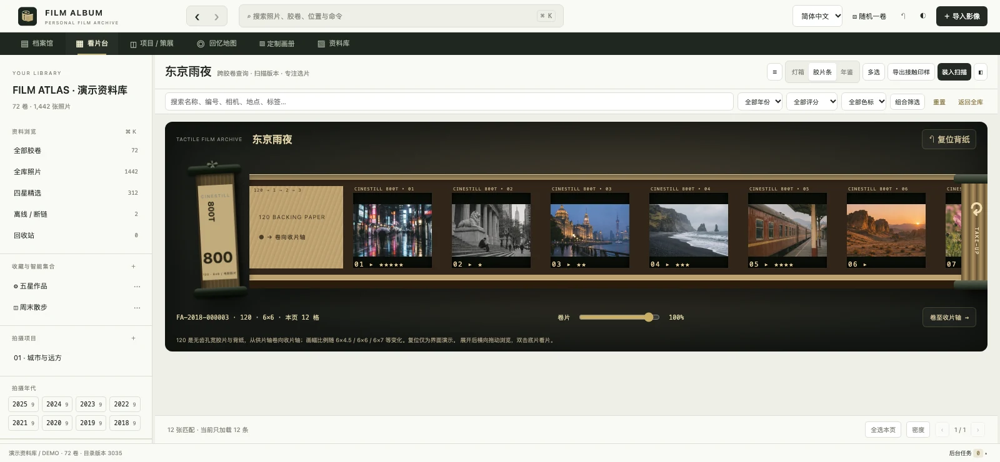

</details>

<details>
<summary>Timeline: browse photographic records by year and month</summary>

**Open:** Archive → Timeline. Rolls follow their actual shooting dates. Use the year index and sort controls to browse the sequence while keeping equipment and physical archive details visible.

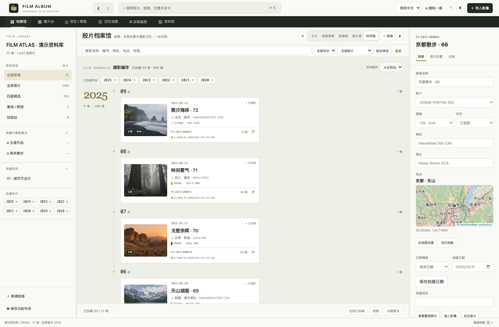

</details>

### Light table: review photographs with their context

**Open:** double-click a photograph in the light table. The bottom thumbnails follow the current query results. Use `F` to fit, `Z` for actual pixels, `I` for EXIF, `H` for the histogram and `1–5` to rate. Two-image / four-image comparisons and scan-version comparisons are also available.

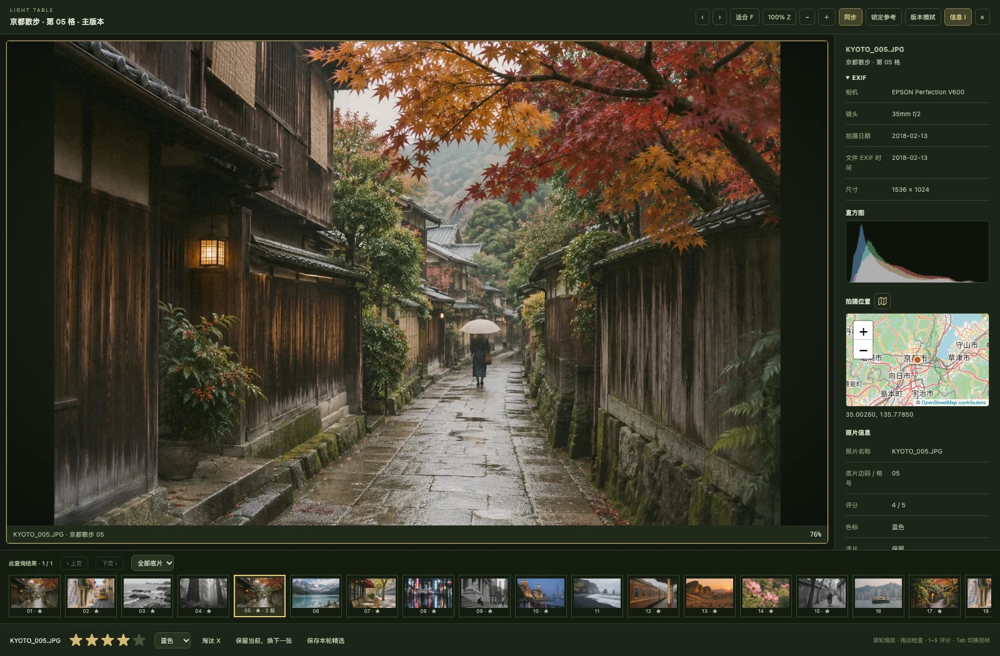

<details>
<summary>Projects: organize candidates and final selections into chapters</summary>

**Open:** Projects / Curation → select a project. Add selected photographs from the light table, filter by chapter and selection stage, switch to the curation canvas or export a portfolio.

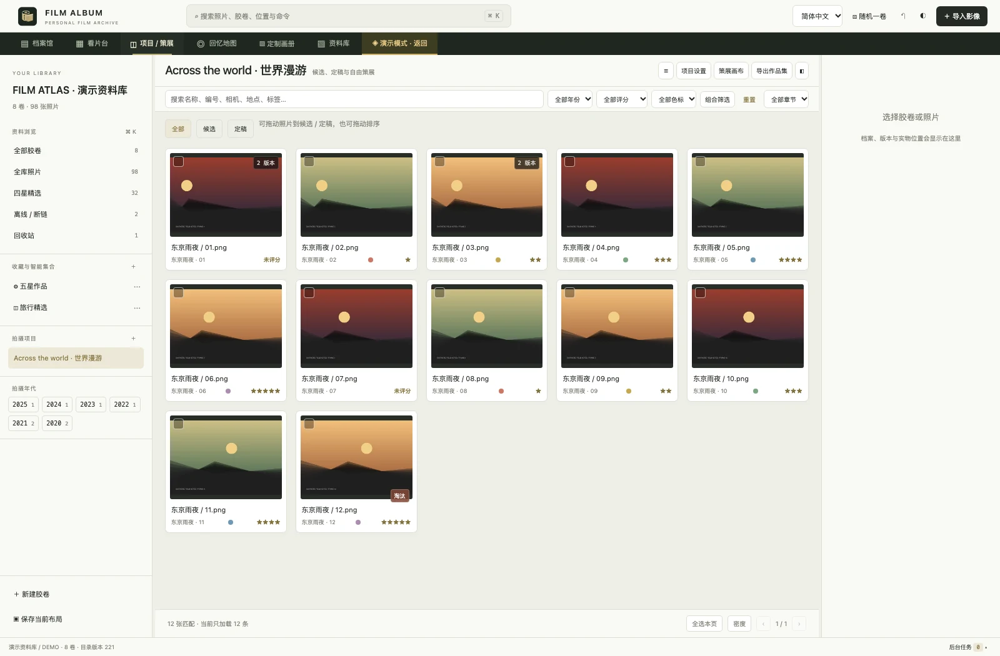

</details>

### Memory map: preview photographs before placing a roll

**Open:** Memory map. Click a roll marker to preview its frames, or search for a region, city, county or street. To place a roll, select it, click the map and explicitly confirm the position. China is the default region; change the default country in library settings.

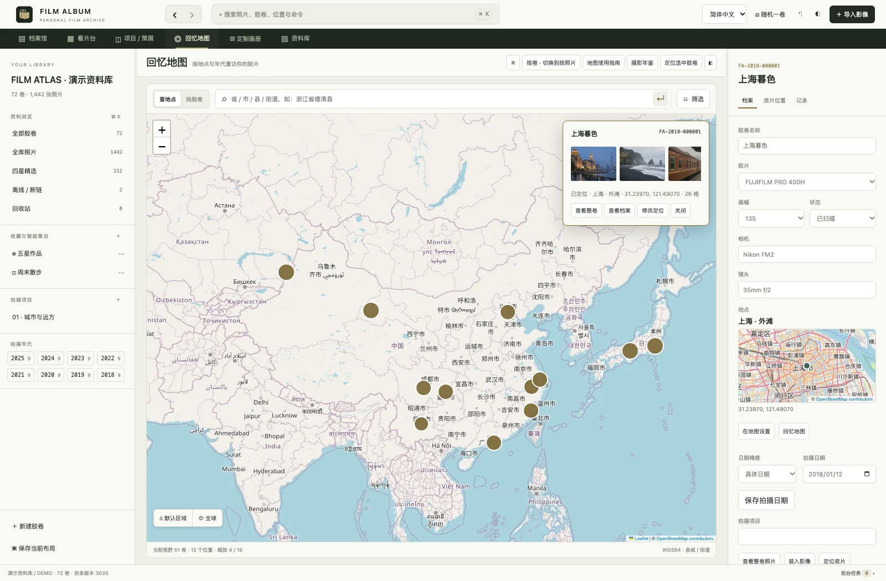

<details>
<summary>Roll lookup: combine location status, dates, places, equipment and film filters</summary>

**Open:** Memory map → position the selected roll. Search names or permanent codes, then combine location status, year, format, film type / stock, date range, place, equipment, project and tag filters. Results include photo previews, coordinates and pagination. Valid coordinates count as located even without a place name.

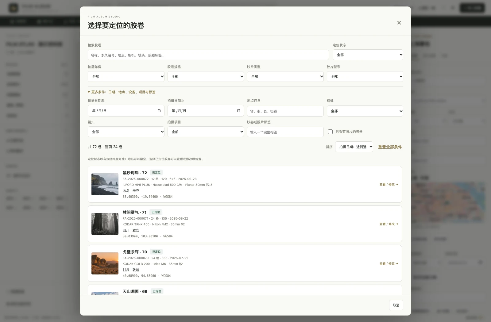

</details>

### Photobooks: find images, lay out precisely and export

**Open:** Custom photobook → create a book or edit the demo book. Filter assets by place, roll and date on the left. Move image frames and resize their corners in the center; double-click to drag the crop. Set millimeter coordinates, rotation and alignment on the right. Save, run Preflight / PDF to check missing images and resolution, then export.

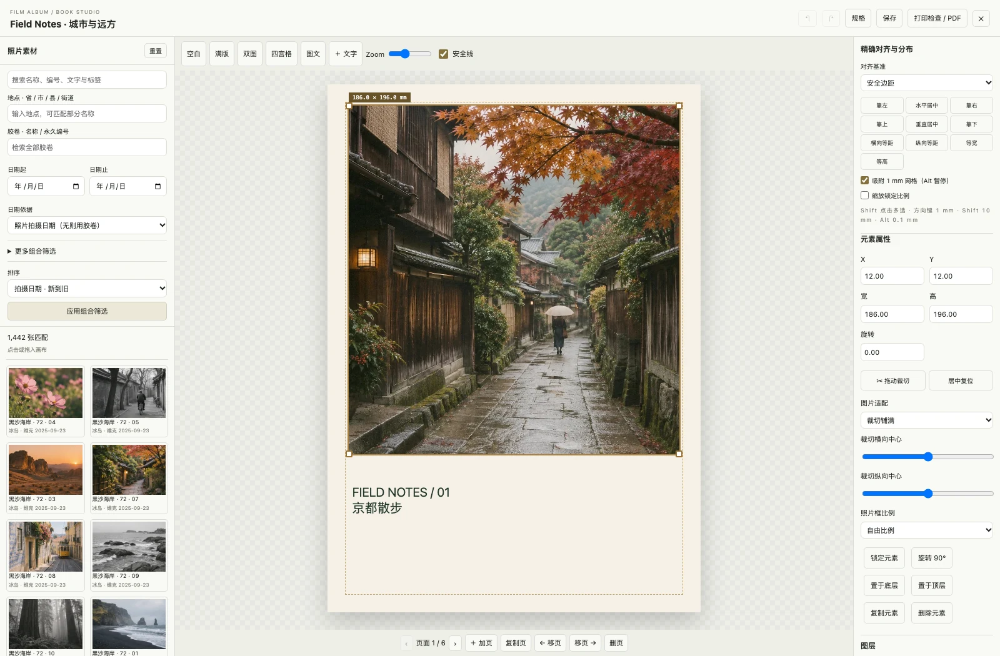

<details>
<summary>Library: check originals, cache offline previews and manage external drives</summary>

**Open:** Library → Overview. Check original availability, preview-cache coverage and disconnected media; run integrity checks or create and verify snapshots under Backup. Generate offline previews while originals are connected. Browsing the cache works after disconnecting a drive; original export and print-quality output still require the originals.

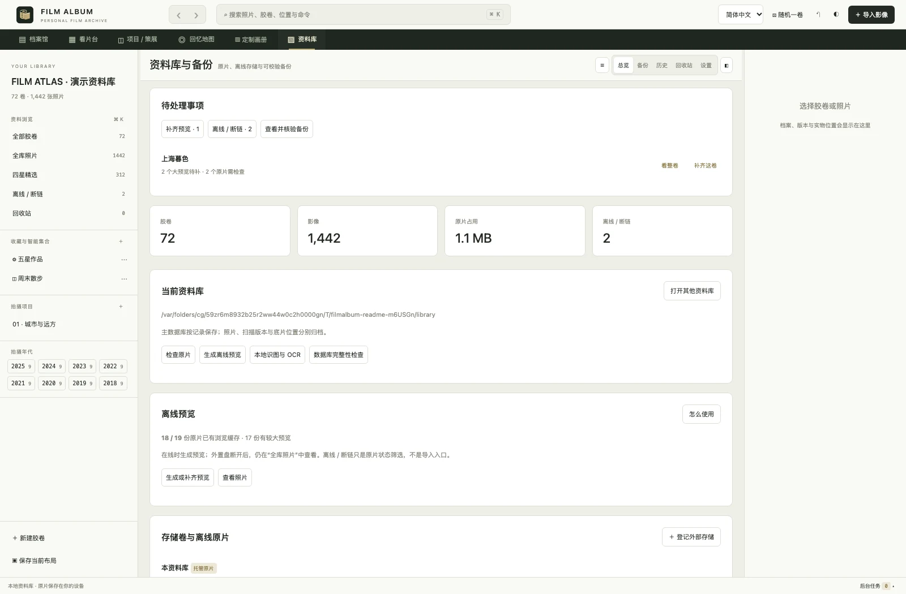

</details>

### Try the same demo library

Start the local server as described in [Run from source](#run-from-source), then open `http://127.0.0.1:8091/?debug=1`:

1. Choose **Generate new demo library** in the experimental entry.
2. Wait for the background task, then choose **Open demo library** in the task center.
3. Explore the workspaces. Use the demo / return entry to return to your regular library afterward.

Demo libraries use separate folders and do not overwrite your original library. The experimental entry is hidden during normal startup. Maintainers can refresh these images using the [capture script](scripts/screenshots.mjs); see [capture notes](docs/screenshots/README.md).

## Run from source

Use Git, Node.js 22.13+ (24 LTS recommended) and npm:

```bash
git clone https://github.com/JackerKun/FilmAlbum.git
cd FilmAlbum
npm ci
npm run desktop
```

For the local web interface, run `npm run serve` and open `http://127.0.0.1:8091`. On macOS, source mode needs Xcode Command Line Tools to compile its image helper on first use. Packaged applications include the compiled helper.

Desktop libraries default to `~/Library/Application Support/Film Album/library` on macOS and `%APPDATA%/Film Album/library` on Windows. Source mode defaults to `data/`. Select an existing library using **File → Open library**; back it up before upgrading.

Core archive, preview and layout operations work locally. Map tiles and place searches contact their configured providers; image analysis and PDF export run locally.

## Build with GitHub Actions

1. Push the complete source, including `.github/`, `scripts/`, `assets/` and `package-lock.json`, to the default branch.
2. Open [Actions → Desktop builds](https://github.com/JackerKun/FilmAlbum/actions/workflows/desktop-build.yml).
3. Choose **Run workflow**, then select the platform and architecture. `all / all` builds all four combinations.
4. Download `FilmAlbum-…` artifacts from the completed run. These outer artifact ZIPs contain the actual installers and app archives.

For a release, push a tag matching `package.json`, for example `v3.0.1`. All four native builds and application smoke tests must pass before the workflow creates a **draft Release** with packages and SHA-256 checksums. Review it and choose **Publish release**. Manual runs only upload Actions artifacts; they do not publish a release.

The release job uses `GITHUB_TOKEN` with `contents: write`; a personal access token is not required. Actions artifacts are retained for 30 days. Published Release assets are the intended download channel.

## Local builds

```bash
./build.sh all               # On macOS: Mac DMG / ZIP and Windows ZIP, both architectures
./build.sh mac --arch host
./build.sh all --plan
npm run check
npm test
```

On Windows, use `./build.ps1 win --arch x64` or Git Bash to produce NSIS setup EXE and ZIP. macOS packages require a macOS build host. See [BUILDING.md](BUILDING.md).

## Current limitations

- Windows supports JPEG / PNG / TIFF previews, local Chinese / English OCR, QR decoding and PDF export; it currently has no HEIC / camera RAW decoding or object classifier. macOS uses ImageIO / Vision, with format support depending on the operating system.
- Photobook PDFs are RGB files with bleed and crop marks, not CMYK / PDF-X certified files or imposed print signatures.
- Packages are not signed with distribution certificates; macOS packages use ad-hoc signing without notarization.
- Simulated metadata benchmarks do not represent a full-scale real TIFF import or long-term NAS stress test. Rosetta tests do not replace native Intel Mac tests.

## Project and third-party licenses

The project currently uses `UNLICENSED`; an open-source license has not been selected. Third-party components retain their own licenses. See [THIRD-PARTY.md](packaging/THIRD-PARTY.md), bundled asset licenses and the [logo design record](assets/LOGO.md).

## Source layout and file workflows

Application code is organized into `src/client/`, `src/server/` and `src/shared/`. Electron code lives in `desktop/`, Swift in `native/`, tests in `tests/` and build tooling in `scripts/`. Use `npm run format` / `npm run format:check` for Prettier. See [architecture notes](docs/ARCHITECTURE.md).

Desktop PDF exports prompt for a native Save location after generation. The task center distinguishes generated PDFs from saved files, and supports saving again after cancellation. Original image extensions and Unicode filenames are preserved.

Offline previews are 640 / 1600 pixel caches inside the current library. Generate them while originals are connected, then browse All photographs after disconnecting the external drive. Offline / missing is a status filter, not an import mode; an empty result when all originals are online is expected. The library overview shows cache coverage and failed items are listed in tasks. Original export and print-quality photobooks still require online originals.
