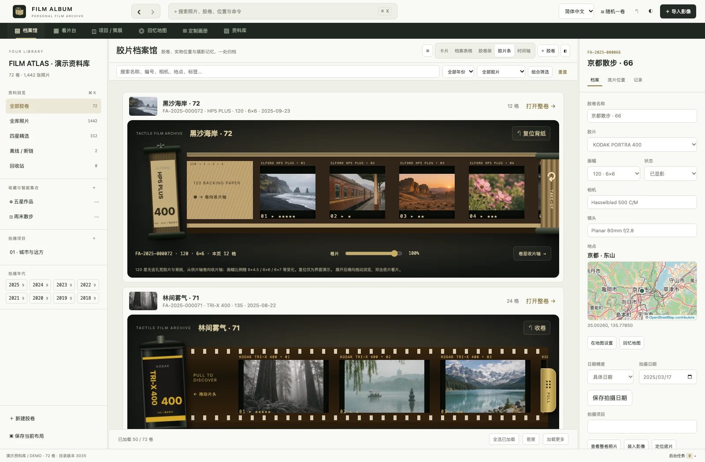
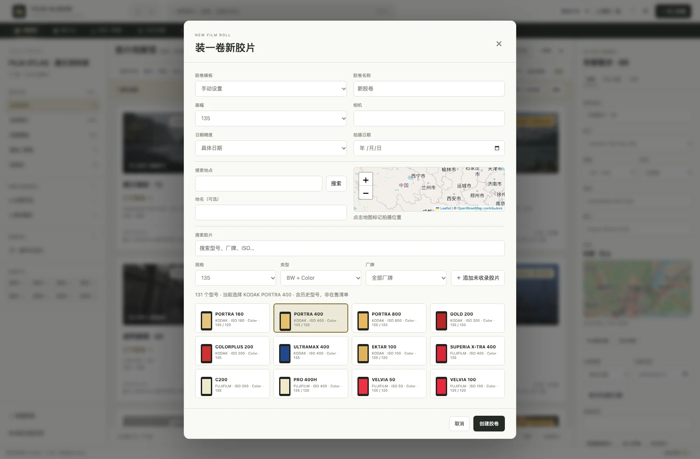

<p align="center">
  
</p>
<h1 align="center">Film Album</h1>
<p align="center">Organize film rolls and scans. Find the negative, the place and the photographs.</p>
<p align="center">
  <a href="README.md">简体中文</a> · English ·
  <a href="https://github.com/JackerKun/FilmAlbum/releases">Downloads</a> ·
  <a href="#interface-tour">Interface tour</a> ·
  <a href="docs/USER_GUIDE.md">Usage guide in Chinese</a>
</p>

Film Album is a local workspace for film photography. Track shooting and development by roll, keep multiple scans of each frame, and turn your selections into photography projects, contact sheets or print-ready photobook layouts. It runs on macOS, Windows and in a local browser.


_The screenshots show the actual interface with **72 rolls and 1,442 visible frame records**. The documentation library reuses 17 AI-generated photographs and includes 135 and 120 film, scan versions, map locations, a project and a photobook._

## Download and launch

| Device                        | GitHub Release installer                      |
| ----------------------------- | --------------------------------------------- |
| Apple Silicon Mac (macOS 13+) | `FilmAlbum-<version>-mac-arm64.dmg`           |
| Intel Mac (macOS 13+)         | `FilmAlbum-<version>-mac-x64.dmg`             |
| Windows Intel / AMD x64       | `FilmAlbum-<version>-windows-x64-setup.exe`   |
| Windows ARM64                 | `FilmAlbum-<version>-windows-arm64-setup.exe` |

On Mac, open the DMG and drag the app into Applications. On Windows, run the installer or extract the entire ZIP before opening `Film Album.exe`. Desktop packages include their runtime. Use `SHA256SUMS` to verify your download. [GitHub Releases](https://github.com/JackerKun/FilmAlbum/releases)

The desktop app checks for the latest stable GitHub Release in the background on startup. If a newer version is available, the download button opens the release page so you can decide when to install it. The Help menu offers a manual update check and a link to GitHub Releases. The local library remains usable offline.

## Interface tour

The screenshots use Simplified Chinese. The top language selector switches the main navigation and common controls to English.

### Roll archive and film strips

Record the film stock, format, camera, date and shooting location when you create a roll. Add lens, development and physical storage details as you archive it. Use the permanent roll code or printed QR label to find the negative.

Browse all rolls as cards, a table, a film shelf, film strips or a timeline. The archive loads 50 rolls at a time as you scroll. Film strips open extended, so you can scroll through several rolls vertically. Back and Forward beside the search field restore the previous view, filters and scroll position.



<details>
<summary>New roll form, timeline and 135 / 120 film handling</summary>




Open a roll and choose Film Strip. The 135 view shows a cassette and two rows of perforations. The 120 view shows a spool, backing paper and wide film. Drag the leader or use the slider to unroll it, then double-click a frame to review it.


</details>

### Scan versions and light table

Preview roll grouping, frame numbers, order and duplicates before importing. Add rescans to the original frame and choose which scan is primary. Review one, two or four photographs with ratings, color labels and rejection flags. Use the thumbnails to move through the current results and press `I` for photo, roll and scan details, EXIF, histogram and location. Open a roll to export a contact sheet.


### Memory map

Browse locations by roll or photograph. Preview a roll from its map marker, search for a place, or set the roll location by placing a pin. The map button beside the shooting location in the photo information panel opens the map with that roll selected.


<details>
<summary>Find a roll to place on the map</summary>

Combine year, format, film stock, location status, place, equipment and tags to find the right roll.


</details>

### Projects and photobooks

Organize candidate and final photographs by chapter. Arrange them on the curation canvas or export a portfolio. In the photobook editor, filter assets, drag to crop, set millimeter coordinates and check bleed and image resolution before exporting an RGB PDF with crop marks.


<details>
<summary>Project photo sequence and library overview</summary>


</details>

## Libraries and offline use

| Mode            | Default library location                                       |
| --------------- | -------------------------------------------------------------- |
| macOS desktop   | `~/Library/Application Support/Film Album/library`             |
| Windows desktop | `%APPDATA%/Film Album/library`                                 |
| Local browser   | `data/` in the project, configurable with `FILMALBUM_DATA_DIR` |

Use File → Open Library to switch to a folder containing `catalog.sqlite`. You can reference originals on an external drive or NAS and generate previews for offline viewing. Reconnect the originals for print and original-file exports. The Library workspace supports integrity checks, trash recovery, and backup creation and verification.

Archiving, photo review and page layout run locally. Map tiles and place searches use the configured online map services. [Usage guide in Chinese](docs/USER_GUIDE.md)

## Run from source

Install Node.js 22.13+ and npm. On macOS or in a Bash environment, use the root launch script.

```bash
git clone https://github.com/JackerKun/FilmAlbum.git
cd FilmAlbum
./start.sh
```

You can also run `npm ci` followed by `npm run desktop` or start the local browser version with `npm run serve` and open `http://127.0.0.1:8091`. The native macOS image engine uses Xcode Command Line Tools in source mode.

Open `http://127.0.0.1:8091/?debug=1` to generate the smaller built-in demo. The README uses a dedicated capture library. Run `node scripts/screenshots.mjs` to reproduce it. [Screenshot generation](docs/screenshots/README.md)

## Development and releases

Run `npm run check` for UI and syntax checks and `npm test` for the test suite. See the build matrix, packaging and draft Release workflow in the [build guide](BUILDING.md). [Architecture notes](docs/ARCHITECTURE.md)

This is preview software. Windows supports JPEG, PNG and TIFF scans. HEIC and camera RAW support depends on platform decoders. Default builds lack distribution signing and Apple notarization.

The project uses `UNLICENSED`. Third-party components retain their own licenses. [Third-party licenses](packaging/THIRD-PARTY.md)
