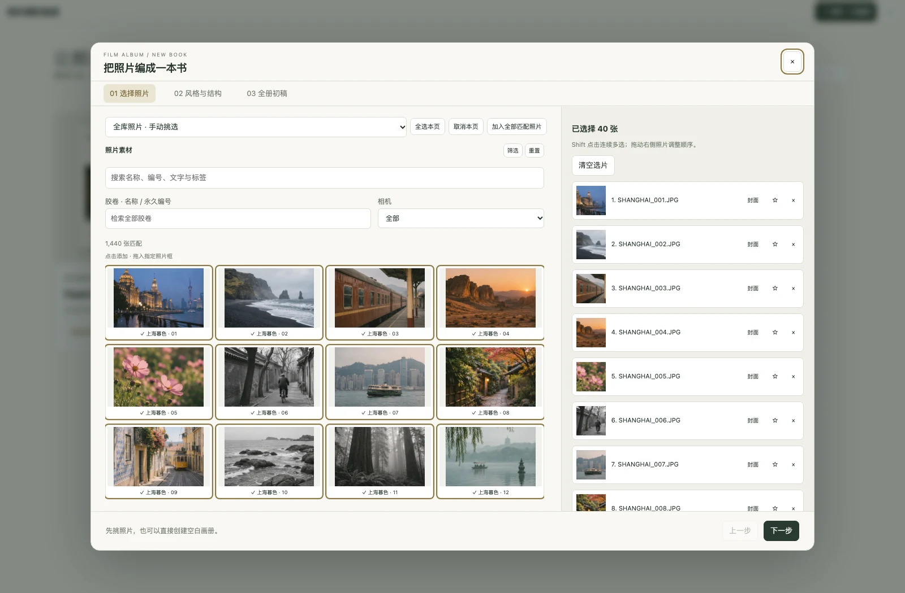
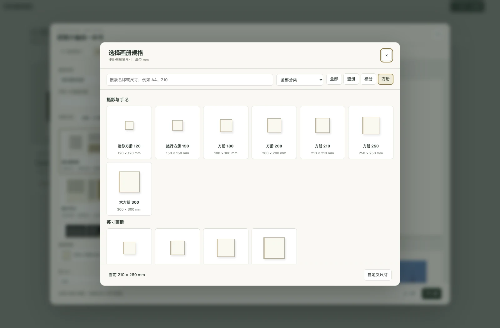
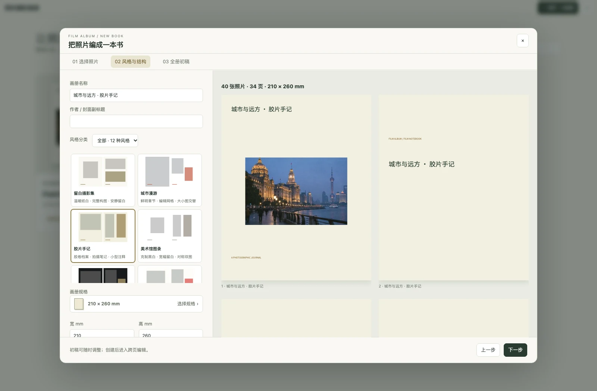
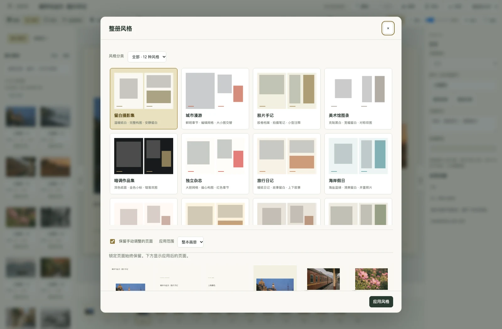
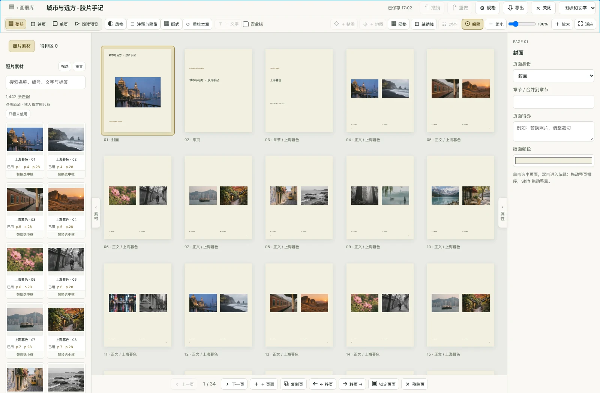
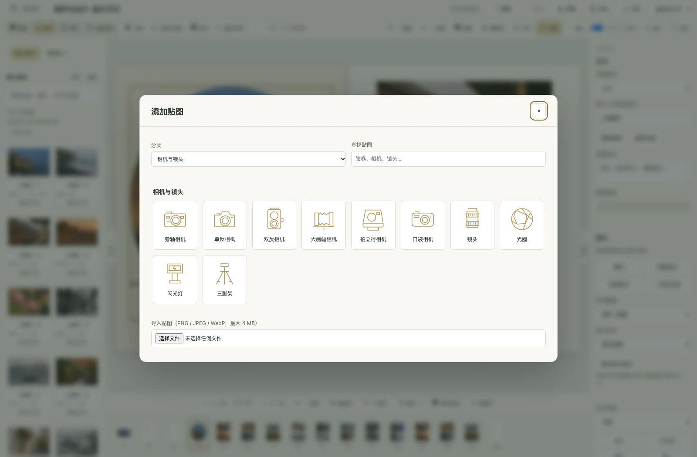
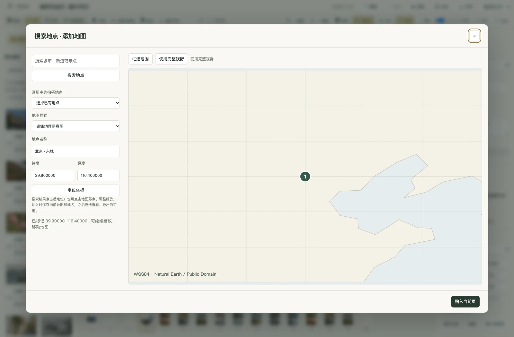
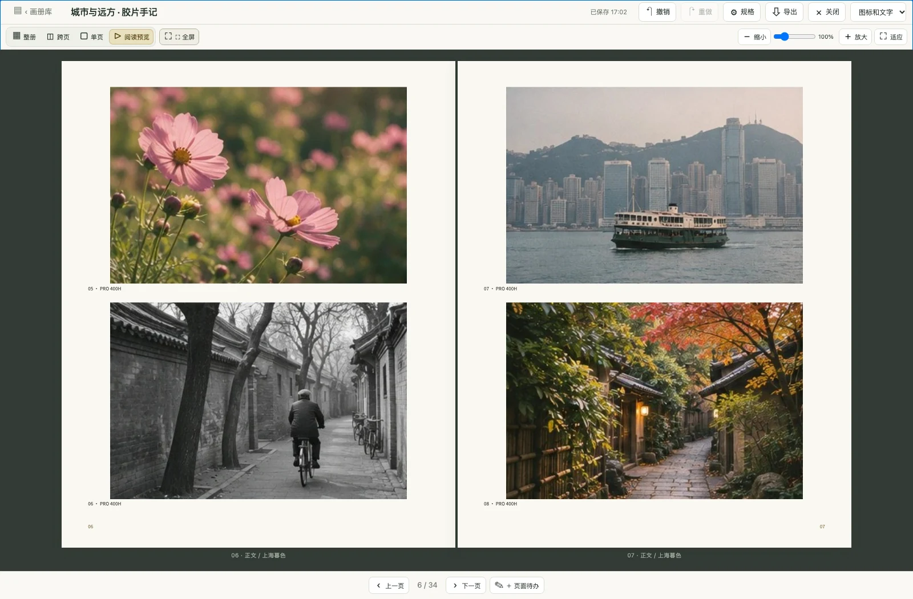

<p align="center">
  
</p>
<h1 align="center">Film Album</h1>
<p align="center">From a roll of film to a photography book.</p>
<p align="center">
  <a href="README.md">简体中文</a> · English ·
  <a href="https://github.com/JackerKun/FilmAlbum/releases">Downloads</a> ·
  <a href="docs/USER_GUIDE.md">Usage guide</a> ·
  <a href="docs/photobook-studio.md">Photobook guide</a>
</p>

Film Album is a local archive and photobook workspace for film photography. Record equipment, shooting, development and negative storage by roll; keep multiple scans of each frame; then turn your selections into projects, contact sheets and books. It runs on macOS, Windows and in a local browser.


_These are fresh captures of the running application, using an isolated demo library with **72 rolls and 1,442 visible frame records**. The fixture reuses 17 AI-generated sample photographs and contains no personal photos. See [screenshot documentation](docs/screenshots/README.md). Source screenshots may include features not yet packaged in a stable Release. Screenshots use Simplified Chinese; documentation links below mostly lead to Chinese guides._

## Download and launch

Choose your installer from [GitHub Releases](https://github.com/JackerKun/FilmAlbum/releases):

| Device                        | Installer                                     |
| ----------------------------- | --------------------------------------------- |
| Apple Silicon Mac (macOS 13+) | `FilmAlbum-<version>-mac-arm64.dmg`           |
| Intel Mac (macOS 13+)         | `FilmAlbum-<version>-mac-x64.dmg`             |
| Windows Intel / AMD x64       | `FilmAlbum-<version>-windows-x64-setup.exe`   |
| Windows ARM64                 | `FilmAlbum-<version>-windows-arm64-setup.exe` |

On Mac, open the DMG and drag the app into Applications. On Windows, run the installer or extract the entire ZIP before opening `Film Album.exe`. Desktop packages include their runtime. Use the release's `SHA256SUMS` to verify downloads.

The app checks for the latest stable GitHub Release in the background at startup. A download link opens the release page; you decide when to install. The Help menu also offers a manual update check and a GitHub Releases link. The local library remains usable offline.

## A workflow built around film

| Stage                    | Tools                                                                                      |
| ------------------------ | ------------------------------------------------------------------------------------------ |
| Create and archive rolls | Film stock, format, camera, lens, dates, development, tags and map locations               |
| Find negatives           | Permanent codes, cabinet / box / binder / page / sleeve locations and QR labels            |
| Scan and select          | Import preview, duplicate checks, scan versions, ratings, color labels and comparison      |
| Organize a story         | Projects, chapters, candidate and final photographs, location maps                         |
| Design a book            | Guided creation, categorized styles and sizes, spreads, stickers, masks, maps and captions |
| Export and preserve      | Contact sheets, three PDF outputs, backups, offline previews and missing-file checks       |

### Roll archive and film strips

Browse all rolls as cards, a table, a film shelf, film strips or a timeline. Load 50 rolls at a time as you scroll. Film strips start expanded for browsing several rolls vertically; individual 135 cassettes and 120 spools have distinct pull-out views. Back and Forward restore earlier browsing positions.

Create rolls with film stock selection, date controls and a shooting location on the map. Batch editing uses field-appropriate controls: choose ratings, colors and states; type notes, tags and equipment names; set locations on a map.


<details>
<summary>New roll, timeline and 135 / 120 film</summary>


</details>

### Review, scan versions and the memory map

Preview roll grouping, frame numbers, ordering and duplicates before importing. Attach rescans to the same frame and choose a primary version. Compare one, two or four photographs with ratings, color labels and rejection flags.

The large-photo information panel brings together photo, roll and scan details, EXIF, histogram and location. Its map shortcut opens the memory map with the current roll selected. Contact sheets remain available as an export from a roll's toolbar.


<details>
<summary>Memory map, roll placement and projects</summary>

Search places, place pins and preview rolls on the memory map. Combine year, format, film stock, location, equipment and tag filters to find a roll to place.


Organize candidate and final photographs by chapter, arrange them on the curation canvas, or continue into a photobook.


</details>

## Turn photographs into a book

The studio guides you through **photo selection → style and structure → a complete first draft**. Filter by roll, camera and other metadata, Shift-select a range, or add matching photographs in bulk. Browse book sizes through proportional thumbnails, categories, orientation filters and search, or enter custom dimensions.

Choose from **12 categorized styles** for portfolios, travel, life events and film archives. Add covers, chapters, roll notes, location maps and a frame index. Books support up to 200 pages; adding all matching photos is limited to 1,200 per batch.


### More room for the page

- **Four views:** overview, spread, single page and reading preview. Zoom in and hold Space while dragging with the left mouse button to pan.
- **Stable toolbars:** selecting different elements does not add or remove top tools. Crop, fit and photo swap controls live in the properties panel. Choose icons and text, icons only or text only.
- **Panels under your control:** use edge handles to expand or collapse materials and properties. Overview respects your panel preferences too.
- **Precise positioning:** align to the page, safe margins or selection; distribute elements evenly; use snapping, a millimetre grid and custom horizontal or vertical guides.
- **Photos and decoration:** shape masks, text, 30 categorized film/camera stickers and custom images. Search a place, draw a rectangular map selection and insert it into a page.
- **Reversible editing:** element context menus, locks, undo/redo and autosave. Displaced content remains available in the pending tray.

In overview, click to select a page, double-click to edit, drag to reorder, or Shift-drag a chapter. Saved map snapshots travel with the book; editing guides stay out of reading preview and PDFs. See the [photobook guide](docs/photobook-studio.md).

<details>
<summary>Photo selection, book sizes and styles</summary>









</details>

<details>
<summary>Page overview, stickers and maps</summary>









</details>

### From reading preview to PDF

Preflight checks missing originals, resolution, text overflow, safe margins, binding and page notes, with links back to affected pages. Export shows an animated waiting state and progress before offering the generated file for saving.

| Output               | Purpose                                               |
| -------------------- | ----------------------------------------------------- |
| Reading PDF          | Screen reading, without bleed or crop marks           |
| Print interior PDF   | Individual pages with configured bleed and crop marks |
| Wraparound cover PDF | Back cover, spine and front cover on one sheet        |

PDFs embed bundled Chinese fonts and retain masks, stickers and map snapshots. Output is currently **RGB**, without CMYK / PDF/X or printer imposition. Set dimensions, bleed, binding and spine width to your printer's requirements.

### Photobook shortcuts

| Action                                   | Shortcut                                                                |
| ---------------------------------------- | ----------------------------------------------------------------------- |
| Pan a zoomed workspace                   | Hold `Space` and drag with the left mouse button                        |
| Zoom                                     | Slider, wheel or trackpad pinch; overview uses `Ctrl / Command` + wheel |
| Temporarily bypass snapping              | Hold `Alt` while dragging                                               |
| Constrain horizontal / vertical movement | Hold `Shift` while dragging                                             |
| Select multiple elements / a photo range | `Shift` + click in the canvas / photo picker                            |
| Nudge elements                           | Arrows: 1 mm; `Shift`: 10 mm; `Alt`: 0.1 mm                             |
| Undo / redo                              | `Ctrl / Command + Z` / `Shift + Ctrl / Command + Z`                     |
| Save immediately                         | `Ctrl / Command + S`; ordinary edits also autosave                      |
| Turn pages in reading view               | Left / right arrow keys                                                 |

## Local libraries and offline use

| Mode            | Default library location                                |
| --------------- | ------------------------------------------------------- |
| macOS desktop   | `~/Library/Application Support/Film Album/library`      |
| Windows desktop | `%APPDATA%/Film Album/library`                          |
| Local browser   | Project `data/`, configurable with `FILMALBUM_DATA_DIR` |

Use File → Open Library to switch to a folder containing `catalog.sqlite`. Reference originals on an external drive or NAS and generate previews before disconnecting. Photobook PDF, print and original-file exports require the originals to be connected. Library tools include missing-file checks, trash recovery, and backup creation and verification.

Archiving, photo selection and layout run locally. Online map tiles, place searches and update checks require a connection. Saved book map snapshots work offline; the offline geographic diagram uses bundled Natural Earth data.

<details>
<summary>Library overview</summary>


</details>

## Preview from source

Install **Node.js 22.13+** and npm. On macOS or in a Bash environment:

```bash
git clone https://github.com/JackerKun/FilmAlbum.git
cd FilmAlbum
./start.sh
```

`start.sh` checks the environment, installs missing dependencies and starts the desktop app. Alternatively:

```bash
npm ci
npm run desktop
```

For the local browser version, run `npm run serve` and open `http://127.0.0.1:8091`. The native macOS image engine requires Xcode Command Line Tools when running from source. `?debug=1` provides a smaller built-in demo; these screenshots use a separate, larger fixture.

## Development and documentation

```bash
npm run check                   # UI entry points and script checks
npm test                        # Automated tests
node scripts/screenshots.mjs     # Main application screenshots
node scripts/qa-photobook.mjs    # Book screenshots, interaction and PDF regression checks
```

[Usage guide](docs/USER_GUIDE.md) · [Photobook studio](docs/photobook-studio.md) · [Screenshots and fixtures](docs/screenshots/README.md) · [Architecture](docs/ARCHITECTURE.md) · [Build and release](BUILDING.md)

This is preview software. The Windows image engine supports JPEG, PNG, TIFF and WebP scans, but does not currently decode HEIC or camera RAW. Default release builds lack distribution signing and Apple notarization. The new photobook format has no dedicated migration workflow for old books.

The project uses `UNLICENSED`. Third-party components retain their own licenses; see [third-party licenses](packaging/THIRD-PARTY.md).
