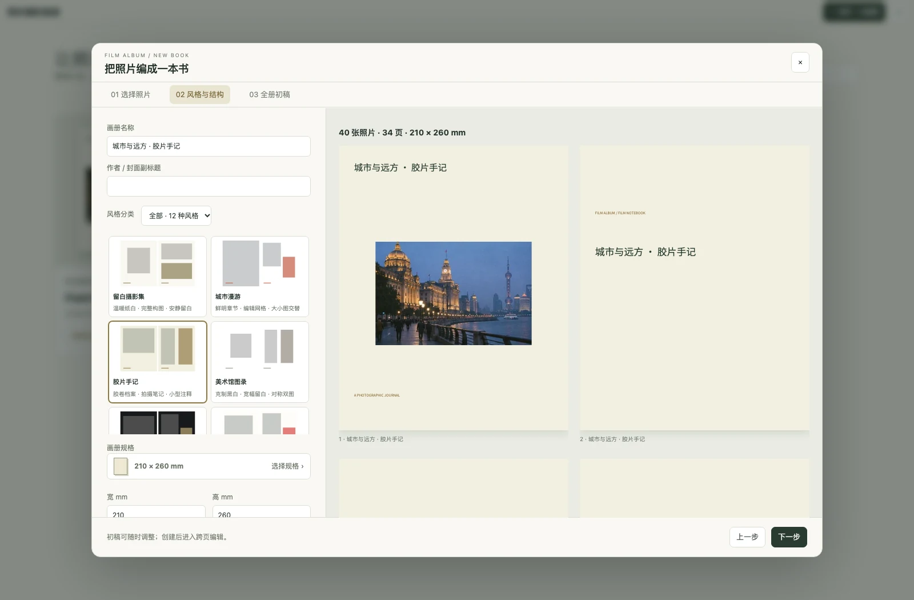
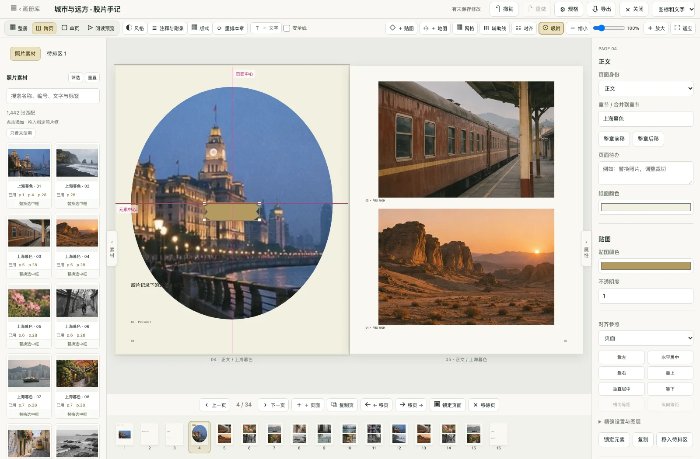
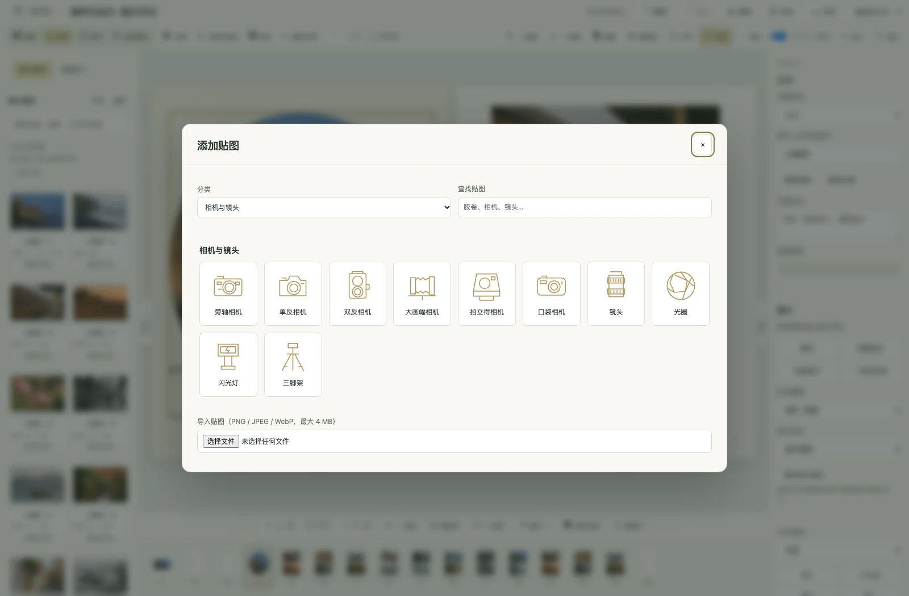

# 画册工作台

画册是一份独立的排版作品。编辑照片框、裁切、文字和风格不会修改照片原片。新版使用新的页面结构，面向重新建册；没有为旧画册提供专门的迁移流程。

## 从照片到初稿

打开「定制画册」，在封面书架上新建画册。也可以从摄影项目的定稿序列进入。

1. **选照片。** 直接按胶卷、相机搜索筛选，也可展开更多条件筛选镜头、胶片、评分、标签等；每次加载 50 张。按住 Shift 点击可连续选择本页的一段照片，也可全选本页、取消本页或加入全部匹配照片。选中后拖动调整顺序，可单独指定封面和重点照片。重点照片会独占正文页，正文仍按选片顺序排列。
2. **选风格和结构。** 从 12 种风格中选择，按摄影作品、旅行纪实、生活纪念、胶片档案分类筛选，缩略图展示单图与双图布局，通过带比例缩略图的规格图库选择尺寸，支持分类、横竖方向和名称搜索；建册和编辑时使用同一图库，也可输入自定义尺寸。设置作者、前言、排版密度及章节分组。可加入胶卷手记、拍摄地图和底片索引。
3. **检查初稿。** 浏览生成的完整页面，再创建画册。每册最多 200 页，建册最多选入 1,200 张照片；照片较多时可提高排版密度或分册。



## 编排和编辑

画册提供全册总览、跨页、单页和阅读四种视图。单页、跨页和阅读默认适应可用区域，并在水平、垂直方向居中。顶部可调整 25%–400% 缩放，滚轮或触摸板捏合可缩放，按住 Alt 滚动可平移放大后的画布；点击「适应」恢复居中。素材与属性侧栏均可独立折叠。整册总览支持缩略图缩放；滚轮上下浏览，Ctrl/Command + 滚轮或触摸板捏合缩放。单击选中页面，可删除、复制或移动；双击（或 Enter）进入跨页编辑。拖动页面调整顺序，按住 Shift 拖动可移动整章，删除和排序均可撤销。页面较多时分批显示，底部页条跟随当前页。离开后重新打开会回到上次编辑的位置。

点击照片框后可以拖动、缩放、裁切或完整显示。拖动默认吸附到页面边缘、中心、安全边距、其他元素边缘和中心，并提示等距间隔；缩放未旋转的元素时也支持边缘吸附。紫色参考线标明对齐位置，松手后消失。顶部「吸附」可开关，Alt 临时关闭吸附，Shift 拖动锁定横向或纵向。多选元素整体移动时保留相对间距。整册视图中的缩略图只作为整页操作，拖动不会选中或替换内部照片。拖入照片替换指定框，原照片进入待排区；使用「交换照片」或拖动交换手柄，可交换两个照片框的内容。「跨页满版」将同一张照片连续铺在两个相邻正文页上，两边裁切和位置联动；任一侧锁定后需先解锁再调整。

版式选择会使用当前照片生成预览。缩减照片框数量时，多余照片进入待排区，手写文字保留。待排区的照片和文字可以重新放回页面。复制、移动页面和重复使用照片均有独立操作。

照片支持矩形、圆角、圆形／椭圆、菱形、六边形、星形和心形蒙版。顶部「贴图」提供 30 款素材，分为胶片与暗房、相机与镜头、档案与标记、纸张与装饰四组，支持分类与名称搜索。包含 135/120 胶卷、齿孔胶片条、片芯、冲洗罐、旁轴/单反/双反/大画幅相机、镜头、光圈、标签等，也支持导入不超过 4 MB 的 PNG、JPEG 或 WebP；透明 PNG 可保留透明背景。贴图可移动、缩放、旋转、调整图层和透明度，内置贴图还可改变颜色；蒙版与贴图均保留在 PDF 输出中。

默认属性侧栏只显示当前内容的常用设置，精确毫米位置、旋转和图层操作放在高级设置中。按方向键微调 1 mm，Shift 为 10 mm，Alt 为 0.1 mm。Command/Ctrl + Z 撤销，Shift + Command/Ctrl + Z 重做，Command/Ctrl + S 立即保存；普通修改也会自动保存。





## 风格、章节与胶片信息

风格包括留白摄影集、美术馆图录、暗调作品集、独立杂志、城市漫游、旅行日记、海岸假日、婚礼纪念、家庭年鉴、拍立得手帐、胶片手记和纪实档案。风格同时设置纸色、字体、强调色与照片布局。类别参考了 [Blurb 的画册用途与模板](https://photos.blurb.com/templates)，具体排版由本项目实现。

更换风格前可预览全册，选择应用到整册或当前章节；默认保留手动调整过的页面，锁定页始终保留。重排章节可调整正文密度，锁定页面及含锁定元素的页面不会被重新编排。

「注释与附录」可以设置照片注释字段、页码，并生成或更新胶卷手记、位置地图和底片索引。底片索引显示照片在正文中的页码，调整页序后自动更新。照片使用的扫描版本会随画册固定，切换档案中的主扫描版本不会悄悄替换已排版的素材。

日期优先采用记录的拍摄日期；扫描文件中的日期不会自动冒充胶片拍摄日期。只记录年份时保留年份精度。

地图页使用随软件附带的 Natural Earth 地理数据绘制概览，不需要在线地图瓦片。仅展示已有坐标的拍摄地，每页最多 12 个位置，标明地名和坐标。连接位置的线默认关闭，可手动开启；它表示排列顺序，不是推断出的真实行程。也可通过顶部「＋ 地图」搜索城市、街道或景点，点击结果定位，调整地图缩放或手动落点，再贴入当前页。还支持选取画册照片已有地点和直接输入坐标。街道底图来自 OpenStreetMap，地图画面、署名、地名和坐标随画册保存；离线查看和 PDF 导出不会重新请求瓦片。搜索和首次加载街道底图需要联网；网络不可用时可选择「离线地理示意图」。选中单地点地图后可重新编辑地点与视野。

工作区放大后，按住空格并用鼠标左键拖动即可平移，光标会显示抓手；松开空格恢复编辑。单页、跨页、阅读预览和整册均支持。平移只改变查看位置，选中元素后保留视野；输入框里的空格仍用于录入文字。

## 对齐、辅助线与快捷菜单

照片、文字、贴图和地图都支持右键菜单，可复制、删除（移入待排区）、锁定、置顶、置底和旋转。右侧属性面板直接显示对齐工具，支持靠左、靠右、靠上、靠下、水平/垂直居中，以及三个或更多元素的等距分布。参照可选择页面、安全边距或所选元素；旋转元素按可见边界对齐，锁定元素不会被移动。

顶部「网格」可随时开关。在「辅助线」中设置 2–100 mm 网格间距，添加指定位置的水平或垂直辅助线，单独控制显示和删除。打开吸附后可吸附到显示的网格与辅助线；这些编辑辅助内容不会进入阅读预览、缩略图或 PDF。网格和辅助线设置按画册保存在本机。

素材栏和属性栏可通过画布两侧的把手展开或收起，整册、跨页与单页共用用户设置的显示状态。顶部工具集合不随选中元素变化；照片的裁切、完整显示和交换操作位于右侧属性栏。吸附、网格、辅助线、裁切和锁定等开关以高亮显示启用状态。

右上角可切换「图标和文字」「仅图标」「仅文字」，用于顶部和底部常用工具。仅图标模式仍保留悬停提示和无障碍名称，显示偏好会在本机记住。

地图窗口采用左侧搜索与坐标、右侧大地图布局。点击「框选范围」后在地图上拖出矩形，可看到裁剪范围与三分线；只保存选框内部的底图，再附上署名、地名和坐标。点击「使用完整视野」取消框选。重新框选即可替换范围，选框与地图样式随地图元素保存；离线地理示意图也可框选。

## 阅读和输出

阅读模式隐藏编辑面板，支持双页翻阅、全屏及页面待办。阅读时使用左右方向键翻页，缩放与编辑模式使用同一套控件。导出检查会列出缺失原片、低分辨率、文字溢出、安全边距、装订和未完成待办，点击问题可回到对应页面或元素。

| 输出         | 用途                                         |
| ------------ | -------------------------------------------- |
| 阅读 PDF     | 无出血和裁切标记，缩小照片以便屏幕阅读       |
| 印刷内页 PDF | 原片质量、出血及裁切标记，按单页顺序输出     |
| 封面展开 PDF | 封底、书脊、封面合成一页；书脊厚度由用户设置 |

点击导出后显示等待动画和当前处理阶段；准备照片时显示进度，字体嵌入与 PDF 生成完成后才打开保存窗口。失败时显示原因并允许重试。

屏幕预览和 PDF 共用内置的思源黑体/宋体字体，PDF 会嵌入字体，并按 CFF 字符映射输出，兼容 macOS 预览。输出为 RGB，不是 CMYK 或 PDF/X，也不自动做印厂拼版。装订方式、出血、安全边距和书脊厚度应按印厂给出的规格设置。当前三种 PDF 导出均会核验原片，导出时需连接原片所在存储。

## 开发验证

```bash
npm run check
npm test
node scripts/qa-photobook.mjs
```

界面回归脚本使用独立的 72 卷、1,442 张照片演示库和临时 Chrome 配置，不修改个人资料库。结果默认保存到系统临时目录的 `filmalbum-book-qa`，包括界面截图、三种实际导出的 PDF 和验证报告。运行需要 Google Chrome，也可通过 `FILMALBUM_SCREENSHOT_BROWSER` 指定 Chromium；输出目录可通过 `FILMALBUM_SCREENSHOT_DIR` 指定。
